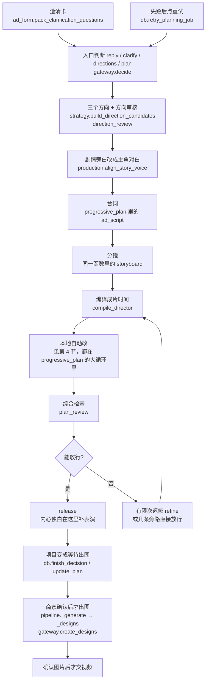

# 剧情方案流水线审计

日期：2026-10-07。这是一份只读审计，没有改代码。对象是「剧情／场景广告」从澄清到出图的整条路。

读这份材料的人不必看实现。结论先说：同一条创作规则经常写在说明书、检查函数和改稿函数三个地方。失败之后不是只有一个出口，而是好几条路都能把一份还没审完的稿标成可以出图。最近三次事故都是这个结构造成的，不是某一句文案写错。

三次事故：

- 状态校正来回改同一对起止，编译停不下来。两个改稿步骤在写同一组字段，循环把「改过」当成「还要再改」。
- 剧情旁白和广告类型对不上，方案直接停掉。声音规则在给方向、开排、放行三处各判一次，判失败的那一下又落在检查点外面。
- 重试只打了一次台词，没有分镜，也没有「正在综合检查」，占位稿被标成完成并去出图。检查点认为上一份分镜已经完成，失败出口又用占位稿顶上。

产品原则保持不变：硬拦住的要少；能自动改的就改；画面和台词的质量要求不删、不放宽。要收的是「谁说了算、失败从哪出去」，不是把规则改少。

## 1. 剧情整条路

商家看到的顺序，和程序里真正干活的函数，是下面这张图。默认开关是：渐进策划开着，三段式联合策划关着，内容初稿关着。所以选完方向之后走的是「台词 → 分镜 → 综合检查」，没有单独的剧本审核。`script_review` 为空是这条路的常态，不是漏记。

每一步谁负责：

| 商家看到的 | 做什么 | 文件和函数 |
| --- | --- | --- |
| 澄清卡 | 最多 4 题，顺序是广告类型、卖点、拍给谁、去向。剧情不留去向。人群从宽：有人群、性别年龄、女生主角或下午茶就不问。 | `app/ad_form.py` `pack_clarification_questions`；卖点 `app/highlight.py`；人群 `app/audience.py`；去向 `app/cta.py` `project_cta_mode` |
| 入口 | 决定这一轮是回话、澄清、出方向，还是直接排方案。已有方案或已选方向不再重问。 | `app/providers/gateway.py` `Gateway.decide`；收口 `app/ad_form.py` `intake_strategy_response` |
| 三个方向 | 本地先收正过长的母题、角色 id、剧情旁白，再校验，再独立审方向。 | `app/strategy.py` `prepare_strategy_ingress`、`build_direction_candidates`；审核在 `gateway.decide` 里调 `direction_review` |
| 声音 | 剧情里有能开口的人时，旁白改成这个人的对白。给方向前改一次，开排前再改一次。 | `app/production.py` `align_story_voice`、`align_selected_story_voice`。开排入口在 `progressive_plan` 开头 |
| 台词 | 脚本规划里的台词方法。渐进策划不单独做剧本审核。 | `app/progressive_planning.py` `progressive_plan`；技能 `app/skills/ads-video-script-planning/` |
| 分镜 | 台词技能加「分镜导演」技能。模型返回镜头，程序不替它编故事。 | 同上；技能 `app/skills/ads-video-storyboard-direction/` |
| 编译 | 把镜头收成真实秒点、说话窗口、分段。这里不改创作，只排时间。剧情末镜会试着收到大约 2 秒。 | `compile_director`；末镜时长 `app/planning.py` `fit_story_insert`；台词落镜 `app/story_logic.py` `snap_declared_speech` |
| 综合检查 | 进度文案是「正在综合检查商品表达、动作与声画计划」。审核对象是编译后的成稿。 | `progressive_plan` 里 `stage` 为 `plan_review`；规则说明 `app/skills/ads-video-plan-review/` |
| 放行 | 通过后补内心独白的表演提示，说话方式仍是这个人的对白。项目状态变成等待出图。 | `progressive_plan` 里的 `release`；落库 `app/db.py` `finish_decision`、`update_plan` |
| 重试 | 声音对不上、结构不完整、容量没改善、占位稿，会丢掉已保存的分镜再排队。别的失败多半只重开最后一步。 | `app/db.py` `retry_planning_job`；判断 `app/story_logic.py` `planning_rerun_storyboard`；回放 `app/planning_session.py` |
| 出图 | 商家确认方案之后才交。场景图、角色四视图、起始状态图可以并行。结果图等自己的起始图。确认图片之后才交视频。 | `app/pipeline.py` `_generate`、`_designs`；出图 `gateway.create_designs`；画面要求 `app/design.py`；视频提示 `app/video_prompt.py` |
| 排队执行 | 一个数据目录只有一个 worker。策划和出图都从这里进。 | `app/main.py` `worker` 调 `pipeline.execute` |

剧情该怎么拍，写在 `app/skills/shared/ad-form-playbooks/scene-story.md`。模型看这份。程序里的检查是另一套，并不自动等于这份说明书。

## 2. 规则写在哪，哪里重复，哪里打架

下面只列剧情会碰到的规则。同一条如果说明书、技能和代码各写一遍，就算重复。代码里「拦住」和「只改不拦」不一致，算打架。

| 规则 | 说明书 / 技能 | 代码里谁说了算 | 重复或冲突 |
| --- | --- | --- | --- |
| 剧情不问去向 | 澄清说明 | `cta.should_ask_cta`、`project_cta_mode` | 一处说了算，清楚 |
| 卖点、人群没写先问 | 澄清说明 | `highlight.should_ask_highlight`、`audience.should_ask_audience`；方向如果直接返回，`intake_strategy_response` 改回澄清 | 入口和打包各看一次，顺序一致 |
| 剧情旁白是主角自己的声音 | 谁开口只在 `ads-video-sound-direction` 第 5 点决定 | 给方向：`prepare_strategy_ingress`、`build_direction_candidates`；开排：`align_selected_story_voice`；放行前：`line_quality.voice_identity_issues` | 三处改或判。没人能开口时仍是旁白，放行时硬停。口播写成旁白、产品片写成对口型也硬停，不自动改 |
| 内心独白、不对口型 | playbook：这一镜没有醒着的听者就走内心独白 | 放行时 `story_logic.settle_inner_monologue` 往画面补「放轻脚步…嘴没有动」；视频提示 `video_prompt` 在这时关掉对口型。说话方式保持 `character_dialogue` | 说明书、放行、视频提示三处。占位稿以前会在放行时被贴上这句表演，看起来像真方案 |
| 不说卖点 | playbook 整段对照 | 台词毛病 `line_quality.script_line_offenses`（「在说卖点」）；改写 `rewrite_director_if_needed`；硬停 `story_logic.story_plan_issues` | 先改一次，改不掉再停。两套名单，改写认得的毛病比硬停多 |
| 不念画面、不用第三人称解说 | playbook | 同上，毛病名「在念画面」「第三人称解说」。`story_explainer_remaining` 只给改写用 | 改不掉不硬停。和「不说卖点」不是同一道门 |
| 不点题 | playbook 末句 | 台词毛病「在点题」；`scrub_story_purposes` 只改镜头的 purpose，不改台词 | 台词点题靠改写；purpose 点题另有一个本地替换。都不是硬停 |
| 后句不重复前句，不邀请已经做完的动作 | playbook 的例子，例如蛋糕已切开又说「你来切」 | `line_quality.drop_stale_story_lines`，只跑一次，本地留空 | 说明书没有单独的硬门。和模型改写是两条路，可能先后改同一句 |
| 末镜是大约 2 秒的插入近景，机位锁死，不推近 | playbook「产品出镜与结尾」 | 时长：`fit_story_insert`，挪不动就保持原样。推近：`shot_craft.lock_story_insert`，在 `video_prompt` 编译提示时才改。硬门 `story_ending_issues` 明确不因残留推近失败 | 说明书写成必须，程序分成「尽量改时长」和「出视频时再改画面」。方案可以带着 6 秒末镜和推近被标成完成 |
| 不要英雄定格、对镜头举产品、商标朝镜头、口号或链接、人物看镜头 | playbook；审核技能 | `story_plan_issues` 硬停。否定句（没有、不要）放过 | 说明书和硬门一致。审核模型还会再看一遍，模型判过、程序没判，或相反，都可能发生 |
| 不要把家用物品带出门 | playbook | `story_ending_issues` 会算出这条，但 `story_plan_issues` 只留下英雄定格和举产品 | 算了却不拦。和产品原则「家用物品带出门不再拦住」一致，和 playbook 的「不要」不一致 |
| 每个好处要有一镜看得见的技法 | playbook「镜头」 | `proof_highlight_issues` 有函数、有测试 | 主循环不调用。说明书在，放行不看 |
| 床上的人要跟着床入画，朝向沿用上一镜 | playbook；写明「方案不算完成」 | `background_issues` 触发一次模型改写；`stamp_background_lines` 本地补一句 | 改写失败就继续。说明书说不算完成，程序可以放行 |
| 同框衣服和发型要分开 | playbook | `cast_distinction_issues` 有函数、有测试 | 主循环不调用 |
| 状态只认声明列表，不从正文猜 | 产品约定 | `accepted_state_changes` 只收对得上的；对不上 `state_change_warnings` 记一笔，不拦 | 清楚。接着 `align_declared_continuity` 会按这份列表改起止，这是另一条会改稿的路 |
| 相邻镜头道具个数要接上 | 验收里的自动修 | `repair_prop_handoff`：只把上一镜结束抄到下一镜起始，不改声明过结果的镜头 | 和状态校正写同一组起止字段。以前会来回改 |
| 台词时钟对上「第几句谁开口」 | playbook 分镜怎么写 | `snap_declared_speech`，在编译里 | 和末镜挪切点可能抢同一刀 |
| 镜头不写比喻、运镜要说得清、收尾要停住 | 分镜技能、`shot-literal` | `shot_craft.shot_rewrite_issues` 先改文字；改不动再 `craft_refine_request` 请模型改一小节；仍不行就 `_accept_craft_issue` 记下继续 | 质量规则还在，但失败可以静默放行 |
| 固定台词不能改、无人声不能加词、选中的商品依据必须进镜头 | 策划合同 | `compile_director` → `_validate_authored_contract`、`validate_production_plan` | 和容量返修叠在一起。估时返修里若改出未确认的事实或角色，现在按「未满足已确认要求」停下，不再说成容量问题 |
| 占位稿不能当完成方案 | 这次事故之后加上的 | `is_degenerate_plan`：两句套话、所有镜头同一句、或每镜都有「放在画面中间，光线稳定」 | 只认这三种样子。别的空泛分镜仍可能放行 |
| 时长 10–60 秒，原生声音，不要独立结尾字卡 | 产品约定 | 时长在项目和编译；字卡不另做一步 | 清楚 |

质量规则没有少。少的是「放行时到底看不看」。高光镜、同框衣服写了却不进放行；床上的人、点题、念画面写了，改不动也不拦。

## 3. 失败或退路仍然能往下走的地方

「标成可以出图」指 `release` 返回方案，`finish_decision` 把项目设成等待出图。下面这些路都可能发生，而且商家看不到「这次检查没过」。

1. 综合检查 `ready` 是 false，但失败项只剩状态衔接。程序先试一次道具交接；没改动就把这一项从问题里拿掉。拿掉之后如果没有别的问题，照样放行，失败的审核记录还写在方案上。`progressive_plan` 在审核失败之后、`issues.pop` 状态衔接那一段。
2. 综合检查没打出来，或审核 JSON 修了一次仍不完整。`stop` 在错误码 `planning_review_incomplete` 时，会拿上一份「还能用」的真稿放行，并删掉审核记录。`gateway.decide` 对同一种错误另有一条挽救，条件也是「有成片段落、又不是占位稿」。
3. 返修抛出「这次修订留着别用」（`RevisionKept`）时，如果手里有一份更早的真稿，直接放行那一份。没有的话，检查过声音和剧情硬门之后，放行当前这份，即使当前审核没过。
4. 镜头工艺那一次窄返修失败，或改完编译不过。记一笔之后继续，不停下。`_accept_craft_issue`。
5. 背景人物改写：模型没返回可用稿，函数返回空，循环继续，原来的问题还在。
6. 镜头文字改写编译失败：丢掉改写，用改之前的稿继续。
7. 这些只记警告、不停下：状态声明对不上镜头、衣服没写进角色外观、状态图衣服和镜头不一致、角色四视图里出现商品、内心独白补了表演提示。
8. 剧情末镜时长不在 1.5–2.5 秒时，`fit_story_insert` 会试着挪切点。台词会掉出节拍，或上一镜给不出时间，就保持原样。不是硬停。所以末镜可以是 6 秒还被放行。
9. 末镜还写着推近：硬门不拦。真正改成锁死机位是在出视频提示时，方案本身可以仍是推近。
10. `skip_review` 为真时，本地改完就 `release`，不打综合检查。
11. 检查点里某一步已经是「完成」，再跑时 `session.call` 直接交回旧结果，不再请求模型。`progress` 发现这一步已完成，连「正在分镜 / 正在综合检查」都不报。重试如果没丢掉分镜，商家就会看到：只有一次台词，然后方案好了。
12. 声音对不上这类错误是在 `stage_call` 外面抛的。检查点里分镜那一步仍是「完成」。以前重试只重开最后一步（常常是台词改写）。现在 `planning_rerun_storyboard` 会丢掉分镜，但这是按错误文案里的几句中文来认的，不是按阶段认的。文案一改，这条就会漏。
13. 占位稿以前会在没有真稿时被编译并放行，于是跳过综合检查。现在 `is_degenerate_plan` 挡住了那三种样子。挡法是「长得像模板」，不是「分镜有没有真的拍完」。

`script_review` 为空不是上面任何一条。渐进策划本来就没有这一步。

## 4. 改稿循环，以及它们怎么绊在一起

主循环在 `progressive_plan` 里，是一个 `while True`。每一轮先 `compile_director`，再按固定顺序做一次本地或模型改写。改了就 `continue`，整份重新编译。上限 24 轮（`MAX_DIRECTOR_PASSES`）。返修另有上限：默认 2 次模型返修（`MAX_PLAN_REFINEMENTS`），内部步数再加 3 就停。审核记录最多修 3 轮。

一轮里按这个顺序碰：

1. 编译失败时的分叉：结构不像分镜，先修一次再重生成一次，仍没有真稿就停。说话窗口里没有这个角色，再要一次分镜（`storyboard_regeneration`），只此一次。容量不够，进入返修。固定台词、无人声、未确认事实，直接停。商品依据映射错了，返修一次，再不行就 `seal_director_evidence` 封上继续。
2. 产品片卖点折叠 `apply_brand_claim_collapse`。剧情通常不进这里。
3. 剧情重复句留空 `drop_stale_story_lines`，一次。
4. 台词毛病改写 `rewrite_director_if_needed`，一次。里面还会再折一次产品片卖点。
5. 点题 purpose 换成中性句 `scrub_story_purposes`，一次。
6. 产品片仍在堆卖点则停。剧情不走这条。
7. 背景人物本地补一句，再视情况请模型改一次。
8. 声音和剧情硬门。不过就不记成「真稿」。
9. 镜头工艺改文字一次；再窄返修一次；失败则接受并继续。
10. 状态对齐 `align_declared_continuity`，然后道具交接 `repair_prop_handoff`。只有起止签名变了才重新编译。结果镜不再被第二轮写回去，这是为了停住来回改。
11. 警告只记不下刀。
12. 综合检查。过了就放行。没过：先看是不是只差道具衔接；否则在次数内 `refine`，或在只剩「说话不自然」时做一次台词收尾再整份重审。

绊在一起的地方：

- 状态对齐和道具交接写的是同一组 `start_state` / `end_state`。一边按声明的结果写，另一边按上一镜的结束写。以前每轮都算「改过」，于是一直编译。现在用签名和「结果镜不再写第二遍」停住。规则还是两条，只是加了刹车。
- 末镜时长、台词落镜、道具交接都可能挪同一刀切点。顺序是编译里先落台词、再收末镜，循环里再改道具和状态。后一步可以破坏前一步。
- 台词改写、重复句留空、点题替换、内心独白补字，都在改镜头或台词正文。内心独白在放行时才补，所以综合检查看到的稿和最终落库的稿可以差一句表演。
- 声音映射改的是方向上的 `speech_mode`，发生在分镜请求的内容里。检查点是按整段请求指纹决定要不要重放的。映射若发生在指纹之外，旧的旁白分镜会被当成新的对白分镜重放。重试丢掉分镜是在补这个洞，不是从指纹上保证。
- `stop` 有两条出口：没有真稿就抛错；审核不完整或返修作废时，又可能放行旧稿。调用方还有第三处（网关）对审核不完整再放行一次。所以「停下」不是一个函数。

## 5. 建议怎么收成一处

不删创作规则，不把自动改改成硬停。收的是所有权。

目标：

- 一条规则只有一个家。说明书告诉模型怎么拍。代码里一个模块只负责「这份剧情稿现在有哪些问题」，返回问题名单，不改稿。
- 改稿只有一条出口。一组有顺序的修改，每条修改只写自己的字段，改完再检查一遍。检查不再偷偷改。
- 「可以出图」只有一个判断。不过这个判断，任何路径都不能 `release`。

放行前必须同时成立：

- 不是占位稿，镜头文案不是彼此抄来的空壳。
- 剧情硬门为空：不说卖点、不看镜头、末镜不是英雄定格、不对镜头举产品、商标不朝镜头、不喊口号或链接。
- 声音方式和类型一致。剧情有人能说时是这个人的对白；内心独白只是表演，不另改成旁白。
- 综合检查真正跑过，并且 `ready` 为真。允许放行的失败必须是一张写死的名单（今天实际上是「只剩状态衔接，且已经试过道具交接」），写在这一个判断里，不散落在 `pop` 和 `RevisionKept` 里。
- 最后一次改稿之后又编译过，放行时不再改正文。内心独白的表演要么放进改稿、在审核前完成，要么明确算成放行后的展示，不混在「审核通过的稿」里。
- 末镜时长、推近、高光镜、床上的人、同框衣服：继续自动改或记警告，但要在这一张名单上写明「不拦」。不要一边在说明书里写「方案不算完成」，一边在代码里放行。

迁移顺序（先加判断，再搬改稿，避免又一次只补症状）：

1. 把第 3 节的旁路收成一个函数，例如「能不能放行」。现有行为先保持不变，只是所有 `release` 都走它。测试：今天会放行的仍放行，今天会停的仍停。全套单测就是这张安全网。
2. 把硬门收成一张表，只由 `story_plan_issues` 和 `voice_identity_issues` 产出。审核模型可以提意见，不能单独决定放行。高光镜、同框衣服先标成「有检查、未接入」，接入时做成自动改或警告，不直接改成硬停。
3. 把 `while True` 里会 `continue` 的本地修改收成一次流水：折叠卖点、重复句、点题、背景、状态、道具、末镜时长。每步只写自己的字段。状态结果镜和道具交接不再写对方的句子。跑两遍结果必须相同。这是防止来回编译的测试，已有签名测试要留着。
4. 模型返修只留一种：带着问题名单，改完必须重新编译、重新综合检查。审核不完整、返修作废、工艺接受，都回到同一步，不许旁路放行。次数上限保持现在的 2 次返修、24 轮编译。
5. 检查点按阶段失效，不按错误文案里的中文。只要分镜之后失败，重试就丢掉分镜及它后面的步骤。声音映射必须算进分镜请求的指纹。测试已有「声音对不上的重试只留下台词阶段」这一条，迁移时改成按阶段断言，避免只匹配某一句错误。
6. 内心独白挪到审核之前的那一次流水里，放行不再改画面句子。说话方式的测试保持：仍是 `character_dialogue`。

风险：

- 第 4 步会让一些今天「审核没过但仍出图」的稿停住。这是预期，要单独看商家是更愿意见到停下，还是见到一份没审完的稿。不要用占位稿把它们再放出去。
- 第 3 步如果仍让两个函数写同一字段，来回编译会回来。两遍相同是这条的验收，不能只看单测里某一次调用。
- 第 5 步会让重试多打一次分镜，多一次模型费用。换来的是不会再跳过综合检查。
- 不要在迁移里删 playbook 的画面和台词要求。未接入的检查先标出来，再决定是自动改还是警告。

怎么证明没有退步：

- 每次只动上面的一步，跑现有全套：`AD_DATA_ROOT` 指向空目录的 `python3 -m pytest -q`，外加 `python3 scripts/check_source.py`。当前计数是 2959 passed、3 skipped、39 subtests。迁移开始前以当时的计数为准，不改历史记录。
- 已经钉住的行为不要松：结果镜不被状态校正写第二遍；剧情旁白有人能说时改成对白；重试会重新分镜并审核；占位稿和完全相同的镜头文案不能放行；末镜时长挪不动就保持；道具交接不改声明过的结果镜；重复句只留空一次。
- 新加的证明只做三件：放行函数对第 3 节每一条旁路都有一个例子；本地改稿跑两遍结果相同；重试按阶段丢掉分镜，而不是按某一句中文。

这份审计不要求现在就做迁移。下次再改剧情停住、重试或占位稿时，先看改动是落在「一个家」，还是又加了一条旁路。
